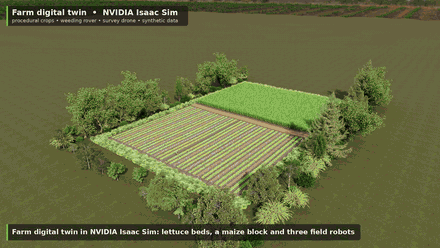
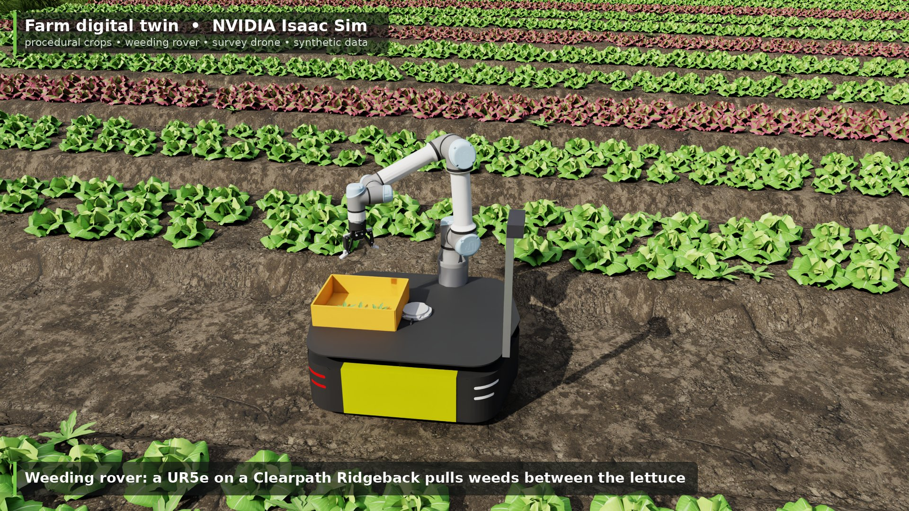
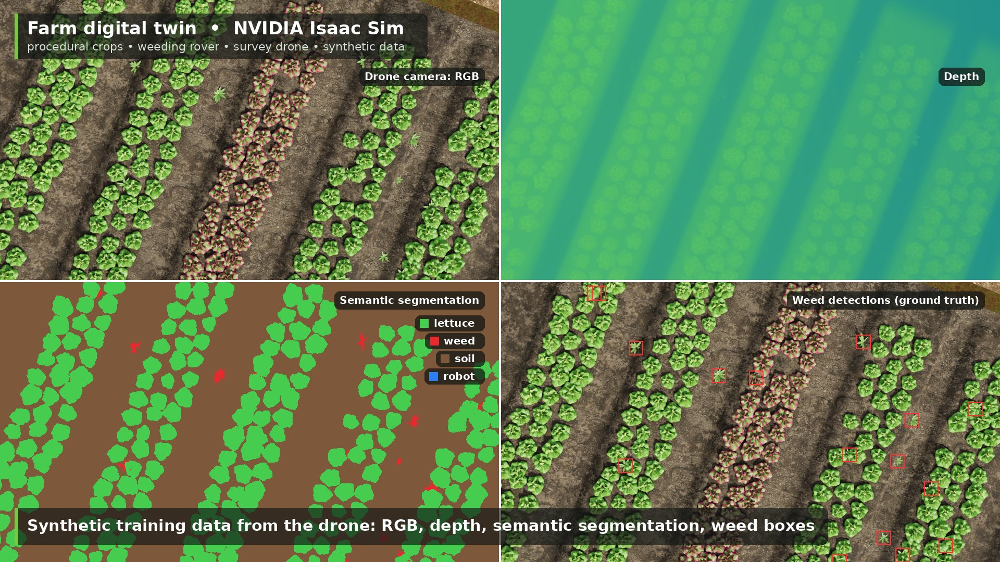
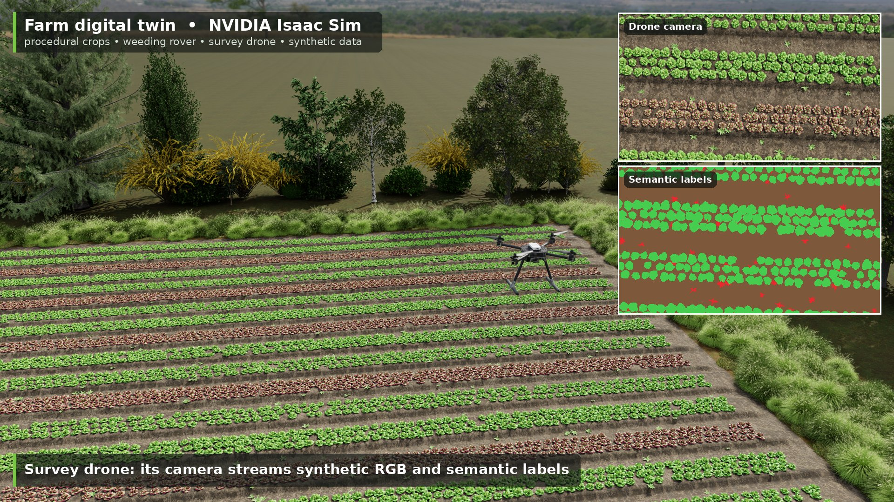
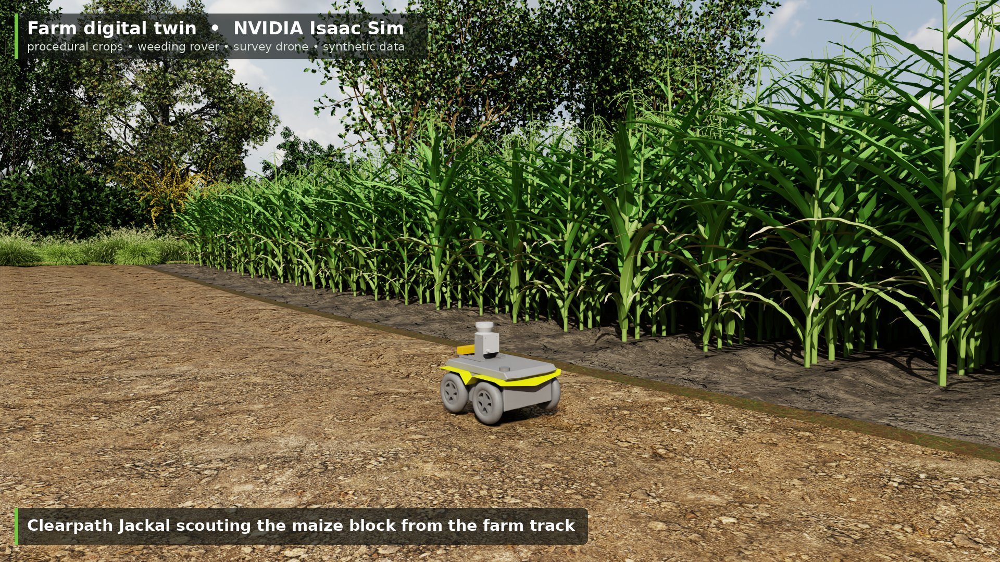

# Farm digital twin in NVIDIA Isaac Sim

[](media/farm_twin.mp4)

*Full 60-second video at 1080p: [media/farm_twin.mp4](media/farm_twin.mp4) (the preview above runs at 2x speed).*

A farm field built from scratch in **NVIDIA Isaac Sim 6.2** and rendered with the RTX renderer through Replicator:
about 30,000 procedurally modelled crop plants on shaped soil, real-world materials and sky, and three field
robots at work. A survey drone streams synthetic training data (RGB, depth, semantic segmentation and weed boxes)
of the kind used to train crop and weed detectors.

| Weeding rover: a UR5e on a Clearpath Ridgeback | Drone camera: synthetic training data |
|---|---|
|  |  |

| Survey drone over the lettuce beds | Clearpath Jackal beside the maize block |
|---|---|
|  |  |

## What is in the scene

* **Crops modelled from botany, not boxes** (`twin/plants.py`, numpy only). Every leaf is a parametric surface
  (base to tip, edge to edge) with smooth normals and its own procedurally painted texture (midrib, veins, colour
  gradients):
  * *head lettuce*: 16-24 obovate, cupped leaves with ruffled edges set at the golden angle (137.5 degrees); the
    inner leaves curl in over the heart and the outer ones arch out and lie down. Green and red (lollo rosso style)
    varieties, the red one with anthocyanin on the leaf edges and tips;
  * *maize near tasselling*: a tapered stalk with node bands, 11-14 long strap leaves with a folded midrib in two
    opposite ranks that rise steeply and droop at the tip, a branched tassel, ears in husks with silk; the lowest
    leaves are senescing;
  * *weeds*: flat, toothed rosettes (dandelion-like) scattered through the beds.

  Several variants of each are instanced across the field with point instancers (random yaw, size and small
  position jitter, a few failed plants), with maize leaves oriented across the rows as in a real crop.
* **Terrain**: one mesh shaped into raised lettuce beds (1.6 m pitch, three rows per bed), maize ridges at 76 cm,
  a farm track with wheel ruts and a gentle undulation, plus a meadow rising into hills around it. Soil, track and
  grass use CC0 photo-scanned PBR materials from [Poly Haven](https://polyhaven.com) (colour, normal and roughness
  maps); the sky is a real HDRI of a farm field (Poly Haven `farm_field`) with a matching sun.
* **Margins**: grass headlands, hedgerow shrubs and trees from NVIDIA's vegetation library.

## The robots

* **Weeding rover**: a Clearpath Ridgeback carrying a UR5e with a Robotiq 2F-85 gripper, a weeding camera mast and
  a bin. It drives down the tramline between the beds and stops at each weed growing in a gap of the first lettuce
  row; the arm goes over the weed, straight down, closes, lifts it out, swings round to the bin and drops it, and the
  bin fills up. The arm is posed kinematically (`twin/arm.py`: forward kinematics over the UR5e's joint frames,
  damped least-squares IK with a log-map orientation error, and the Robotiq finger linkage). Every move of the cycle
  (`twin/timeline.py`, `WeedPick`) follows its Cartesian path with IK solved step by step from the previous step,
  sweeping round the base on an arc for the long moves, so the arm stays on one smooth posture: joint steps stay
  under 8 degrees per frame and the weed hangs from the gripper exactly as it was grasped.
* **Survey drone**: a Holybro X500, built from PX4's official model (`tools/convert_x500.py` converts its
  meshes: carbon frame, landing gear, motors and propellers), flies a lawnmower survey at 11 m with rounded turns;
  its propellers spin. Its downward camera is a second
  Replicator render product with three annotators: RGB, distance to the image plane and semantic segmentation.
  Weed boxes come from the scene's ground truth projected through the camera model.
* **Clearpath Jackal** scouting along the maize block from the farm track.

The assets' physics (rigid bodies, joints, articulations) is switched off so the robots follow the timeline exactly.
The robots rest on their wheels (never sinking into the soil) and the wheels roll with the distance driven: each
wheel turns about its axle through its own centre by distance / radius.

## Run it with Docker

The image is NVIDIA's Isaac Sim 6.2 container with this repository's scene code and its CC0 textures and sky
baked in. You need an NVIDIA RTX GPU, a recent NVIDIA driver, the
[NVIDIA Container Toolkit](https://docs.nvidia.com/datacenter/cloud-native/container-toolkit/latest/install-guide.html)
and an [NGC](https://ngc.nvidia.com) login to pull the base image (`docker login nvcr.io`).

```bash
docker build -f docker/Dockerfile -t farm-twin .

docker run --rm --gpus all -v "$PWD/out:/out" farm-twin preview          # one still per shot -> out/preview/
docker run --rm --gpus all -v "$PWD/out:/out" farm-twin frames 300,900   # chosen frames      -> out/frames/
docker run --rm --gpus all -v "$PWD/out:/out" farm-twin render           # the 60 s film      -> out/farm_twin.mp4, .gif
docker run --rm --gpus all farm-twin test                                # offline checks (no GPU work)
docker run --rm -it --gpus all -v "$PWD/out:/out" farm-twin shell        # a shell inside the image
```

The entrypoint's `test` and `frames` modes were checked inside the `nvcr.io/nvidia/isaac-sim:6.2.0` image the
Dockerfile builds on (all offline checks pass and a frame renders); the image itself was built and run on rented
GPU hosts without Docker-in-Docker, so `docker build` follows the standard pattern but was not run on them.

Or with Compose, which also keeps Isaac Sim's shader cache between runs:
`docker compose -f docker/docker-compose.yml run --rm farm preview`.

Options (environment variables): `RES=1280x720` for a faster, smaller film; `SUBFRAMES=16` for cleaner frames;
`FARM_FIX_DRIVER=1` on cloud hosts that mount only the NVIDIA compute libraries (it installs the matching graphics
and RTX user-space libraries); build with `--build-arg FETCH_ASSETS=0` to download the textures at run time instead.

## Run it without Docker

Inside an Isaac Sim 6.2 installation or container:

```bash
bash twin/get_assets.sh /root/assets                                          # Poly Haven textures and HDRI (CC0)
/isaac-sim/python.sh twin/farm.py --assets /root/assets --out frames --preview # one still per shot
/isaac-sim/python.sh twin/farm.py --assets /root/assets --out frames           # all 1800 frames
python tests/run_tests.py                                                     # needs only numpy and Pillow
```

`farm.py` options: `--res 1920x1080`, `--subframes 8`, `--frames 105,960` (single frames), `--start/--end` (render
a chunk, e.g. to split the film over several GPUs), `--seed 7` (planting layout), `--density 1.0` (fewer plants for
quick tests).

### Rendering on a rented cloud GPU

The film was rendered headless on a rented RTX 4090 (Vast.ai) in the `nvcr.io/nvidia/isaac-sim:6.2.0` image, at
about 0.95 s per 1080p frame (~30 min for the film; the box cost about $0.50 per hour). `twin/run_all.sh` renders
and encodes; `twin/watchdog.sh` makes the box delete itself 45 minutes after the job ends (time to download the
results) or after a hard time limit, using the instance's own scoped API key, so a rented GPU never sits idle.

## How it works

The full design notes, with the numbers behind each choice (field layout, plant geometry, materials and light, the
weeding cycle's IK, drone data, shot list, performance and limitations), are in **[docs/DESIGN.md](docs/DESIGN.md)**.

## Files

* `twin/plants.py` - procedural lettuce, maize and weed meshes and their leaf textures
* `twin/farm.py` - the Isaac Sim scene (terrain, crops, margins, sky, robots), drone camera data and overlay
* `twin/timeline.py` - weeding cycle, drone survey, Jackal route and camera shots (numpy only)
* `twin/arm.py` - UR5e forward and inverse kinematics and the Robotiq 2F-85 finger linkage
* `twin/assets/x500.npz`, `tools/convert_x500.py` - the Holybro X500 drone converted from PX4's model
* `tests/test_offline.py`, `tests/run_tests.py` - checks that run without Isaac Sim (plant meshes, arm reach and
  smoothness, weed hand-over to the bin, drone speed, film length)
* `docker/` - Dockerfile, entrypoint (preview, frames, render, test, shell) and Compose file
* `twin/run_all.sh`, `twin/watchdog.sh`, `twin/fix_driver.sh`, `twin/get_assets.sh` - cloud rendering helpers
* `twin/probe.py` - prints the prim tree and sizes of the robot assets (used to place them)

Textures and HDRI: Poly Haven (CC0). Robot and vegetation assets: NVIDIA Isaac Sim asset library. Holybro X500
model: [PX4-gazebo-models](https://github.com/PX4/PX4-gazebo-models) (BSD-3-Clause, Copyright PX4 Development Team).
